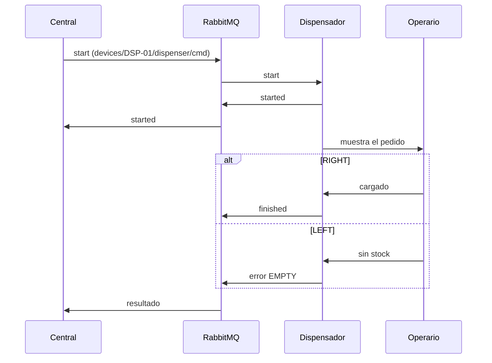

# Dispensador manual — Warehouse USAL

Firmware para un dispensador operado por una persona, en una parada del depósito. Cuando llega un vehículo, la pantalla muestra el pedido y el operario responde con un botón: **cargado** o **sin stock**.

<p align="center">
  <code>WeMos D1 R1 (ESP8266)</code> · <code>LCD Keypad Shield 16×2</code> · <code>MQTT sobre RabbitMQ</code>
</p>

## Contexto

Warehouse USAL es un proyecto universitario que simula un depósito automatizado:

- **Backend:** recibe los pedidos de los clientes y los convierte en órdenes.
- **Central:** un servicio que coordina los vehículos y decide a qué paradas va cada uno.
- **Vehículos:** cada uno es un rover con una cámara. El rover avanza por el depósito y la cámara reconoce un código QR pegado en cada parada.
- **Dispensadores (este repo):** están en algunas paradas. Ahí el vehículo frena, una persona carga el producto y le avisa al sistema que terminó.

```
Backend ──► Central ──► Rover  ──► llega a la parada (QR)
                │
                └────► Dispensador ──► el operario carga y pulsa un botón
                            │
                            └──► la central deja seguir al rover (o cancela la orden)
```

La central y los dispositivos no se hablan directamente: se comunican por mensajes MQTT a través de un broker RabbitMQ. El formato de esos mensajes lo define el protocolo del equipo de la central. La parte que corresponde al dispensador está resumida más abajo, en [Cómo se comunica](#cómo-se-comunica).

## Cómo se usa

| Botón | Cuándo | Qué hace |
|---|---|---|
| **RIGHT** | Hay un pedido en pantalla | Cargado: avisa a la central y el vehículo sigue |
| **LEFT** | Hay un pedido en pantalla | Sin stock: la central cancela la orden |
| **UP** (mantener 3 s) | No hay pedido | Abre el portal WiFi para configurar |

Ningún botón hace nada fuera de esos casos.

### Pantallas

```
┌────────────────┐   ┌────────────────┐   ┌────────────────┐
│Esperando orden │   │ORD-1002        │   │Esperando orden │
│UP 3s = WiFi    │   │RIGHT=OK LEFT=NO│   │Ult: CARGADO    │
└────────────────┘   └────────────────┘   └────────────────┘
     En reposo          Llegó un pedido      Después de RIGHT
```

| Línea de arriba | Significado |
|---|---|
| `Esperando orden` | Conectado y listo |
| `Sin WiFi` | No encuentra la red: mantener UP 3 s para cambiarla |
| `Sin servidor` | Hay WiFi pero no llega al broker: revisar la IP en el portal |

| Línea de abajo | Significado |
|---|---|
| `Ult: CARGADO` / `Ult: SIN STOCK` | Último resultado enviado |
| `Ult: VENCIDO` | Nadie respondió el último pedido en 60 s |
| `Enviando...` | Se pulsó sin conexión: el resultado se manda al reconectar |

## Cómo se comunica

El dispensador nunca habla con el backend ni directamente con la central: los dos se conectan al mismo broker RabbitMQ (plugin MQTT, puerto 1883).



### Mensajes

```jsonc
// Central → devices/{id}/dispenser/cmd
{ "cmd": "start", "request_id": "ORD-1002:1", "order_id": "ORD-1002", "vehicle_id": "VHC-001" }

// Dispensador → devices/{id}/dispenser/event
{ "event": "started",  "request_id": "ORD-1002:1" }
{ "event": "finished", "request_id": "ORD-1002:1" }
{ "event": "error",    "request_id": "ORD-1002:1", "code": "EMPTY" }
```

| Tópico | Dirección | Contenido |
|---|---|---|
| `devices/{id}/dispenser/cmd` | Central → Dispensador | `start`, `telemetry_request` |
| `devices/{id}/dispenser/event` | Dispensador → Central | `started`, `finished`, `error` |
| `devices/{id}/dispenser/status` | Dispensador → Central | `{"online":true}`; Last Will `{"online":false}` |
| `devices/{id}/dispenser/telemetry` | Dispensador → Central | Respuesta a `telemetry_request` |
| `devices/broadcast/telemetry_request` | Central → todos | Pedido de telemetría |

### Reglas

- **Nunca despacha dos veces.** Si la central repite un `start`, el dispensador repite su respuesta (`started` o el resultado) sin pedir otra carga.
- **Un pedido por vez.** Si llega otro `start` con uno en curso, contesta `error` con código `BUSY`.
- **Vence a los 60 s**, igual que `DispenserFinishTimeoutSec` en la central. Después la central cancela la orden y el rover vuelve al inicio.
- **Sin conexión no se pierde el resultado.** Si se pulsa sin conexión, el resultado se manda al reconectar. Si la placa se reinicia, sí se pierde.

## Puesta en marcha

### 1. Compilar y cargar

Necesita el paquete de placas `esp8266` 3.1.2 y estas bibliotecas:

| Biblioteca | Versión probada |
|---|---|
| PubSubClient (Nick O'Leary) | 2.8 |
| ArduinoJson (Benoit Blanchon) | 7.4.3 |
| WiFiManager (tzapu) | 2.0.17 |
| LiquidCrystal | 1.0.7 |

Desde Arduino IDE, elegir la placa **WeMos D1 R1** y abrir [`dispensador/dispensador.ino`](dispensador/dispensador.ino). O con `arduino-cli`:

```sh
arduino-cli compile --fqbn esp8266:esp8266:d1 dispensador
arduino-cli upload  --fqbn esp8266:esp8266:d1 -p /dev/cu.usbserial-XXXX dispensador
```

### 2. Configurar desde el celular

La primera vez la pantalla muestra una red `DSP-XXXXXX` y su clave.

1. Conectarse a esa red desde el celular. Si no se abre la página sola, entrar a `http://192.168.4.1`.
2. Elegir el WiFi del depósito (2,4 GHz) y completar los datos del broker:

   | Campo | Valor |
   |---|---|
   | IP del servidor MQTT | IP de la máquina donde corre la central con RabbitMQ |
   | Puerto | `1883` |
   | Usuario / Clave | los del broker (en desarrollo, `admin_admin` / `admin`) |
   | ID del dispensador | `DSP-01`, `DSP-02`, … (único por dispensador) |

3. Guardar. La placa se reinicia y muestra `Esperando orden`.

Para cambiar la configuración después, mantener **UP 3 segundos** sin un pedido en pantalla. El portal se cierra solo a los 3 minutos.

### 3. Asociarlo a una parada

En el panel de la central (`:8080`, sección *Dispensers*), asociar el ID del dispensador con el QR de la parada. En la placa no se configura nada más.

## Probar sin la central

Se puede hacer de central a mano con un RabbitMQ local. La carpeta [`prueba_mqtt`](prueba_mqtt) tiene el `compose.yaml` y la guía completa.

```sh
cd prueba_mqtt
docker compose up -d rabbitmq

# Terminal 1: ver lo que responde el dispensador
docker compose run --rm mqtt -h rabbitmq -u admin_admin -P admin \
  -t 'devices/DSP-01/dispenser/event' -v

# Terminal 2: mandar un pedido
docker compose run --rm --entrypoint mosquitto_pub mqtt -h rabbitmq -u admin_admin -P admin \
  -t 'devices/DSP-01/dispenser/cmd' \
  -m '{"cmd":"start","request_id":"ORD-1:0","order_id":"ORD-1","vehicle_id":"VHC-001"}'
```

Debe aparecer `started`. Al pulsar RIGHT aparece `finished`, y al pulsar LEFT, `error` con `EMPTY`.

También sirve el panel de RabbitMQ (http://localhost:15672): *Exchanges* → `amq.topic` → *Publish message*, con routing key `devices.DSP-01.dispenser.cmd`.

### Pruebas hechas en la placa

| Caso | Resultado |
|---|---|
| Conecta al broker | ✅ |
| `start` → `started` y pedido en pantalla | ✅ |
| RIGHT → `finished` | ✅ |
| LEFT → `error EMPTY` | ✅ |
| `start` repetido → misma respuesta, sin otra carga | ✅ |
| `start` con otro pedido en curso → `error BUSY` | ✅ |
| Pedido sin respuesta → vence a los 60 s y el siguiente entra | ✅ |

## Hardware

El LCD Keypad Shield va montado sobre la D1 R1.

| Señal LCD | Pin |
|---|---|
| RS, E | D8, D9 |
| D4–D7 | D4–D7 |

Los cinco botones comparten **A0** a través de un divisor de resistencias. Valores medidos en esta placa:

| Botón | A0 | Uso |
|---|---|---|
| RIGHT | 13 | Cargado |
| UP | 177 | Portal WiFi |
| DOWN | 432 | — |
| LEFT | 674 | Sin stock |
| SELECT / suelto | 1024 | — |

Los umbrales están en `keyFromA0()`. Si se cambia el shield o la placa, abrir el monitor serie a 115200: imprime `A0=…` cada vez que cambia la tecla.

> [!WARNING]
> El shield está pensado para Arduino de 5 V y el ESP8266 trabaja a 3,3 V. No se midió el voltaje que el shield entrega en A0. Funciona, pero conviene medirlo antes de dejarlo en uso permanente.

## Limitaciones conocidas

- La versión pública de la central ([`G5_Version_NET`](https://github.com/Warehouse-USAL/G5_Version_NET)) todavía no manda `start` a los dispensadores. El firmware sigue el protocolo acordado con el equipo de la central y queda a la espera de esa versión.
- Las publicaciones salen con QoS 0 (límite de PubSubClient).
- El pedido en curso vive en memoria: si la placa se reinicia, se pierde. La central lo cancela al vencer su timer.
- Las credenciales se guardan sin cifrar en la placa y el broker de desarrollo no usa TLS.

## Estructura

```
.
├── README.md
├── INTEGRACION.md                  # revisión del backend y la central
├── dispensador/
│   ├── dispensador.ino             # firmware del dispensador
│   └── LEEME.md                    # guía de prueba paso a paso
└── prueba_mqtt/
    ├── compose.yaml                # RabbitMQ con MQTT + cliente mosquitto
    └── LEEME.md
```
